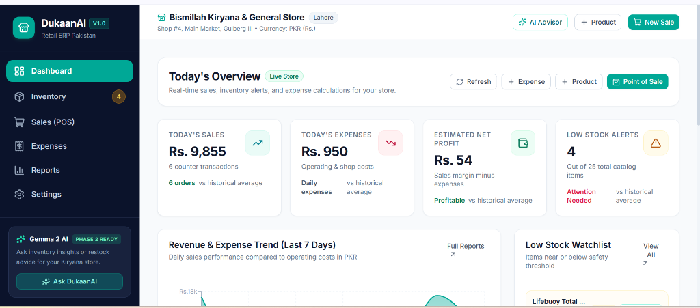
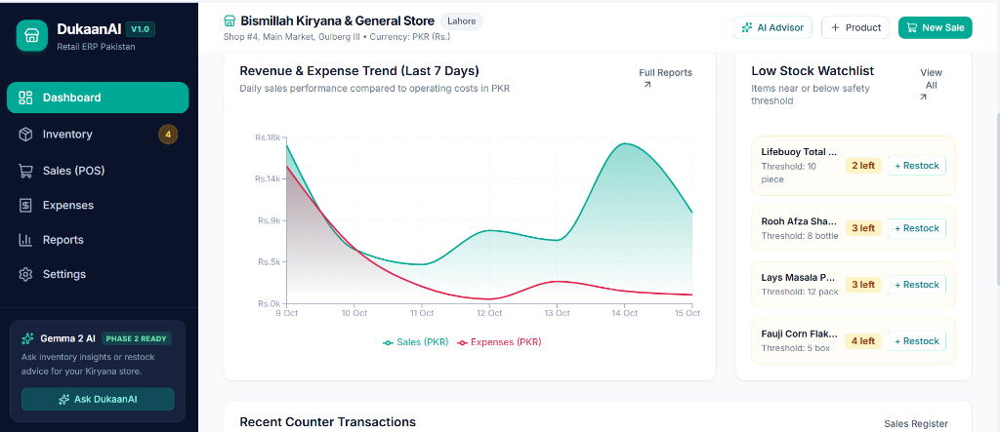
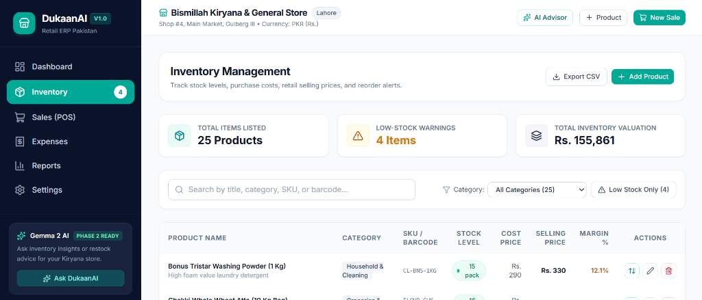
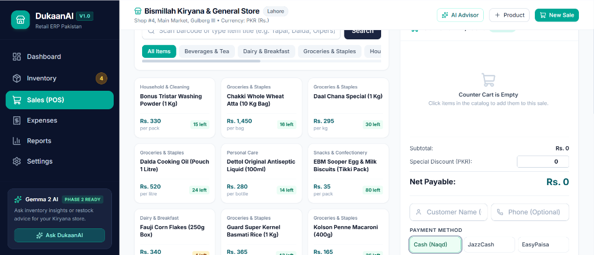
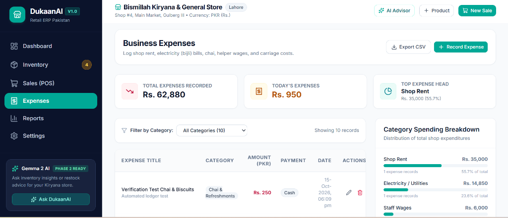
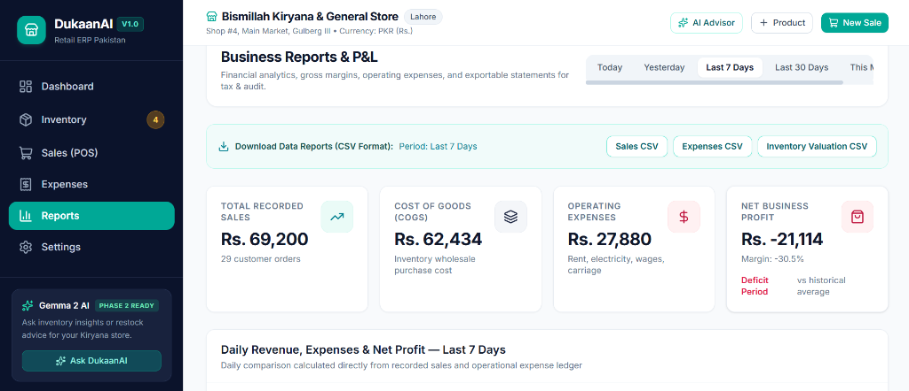
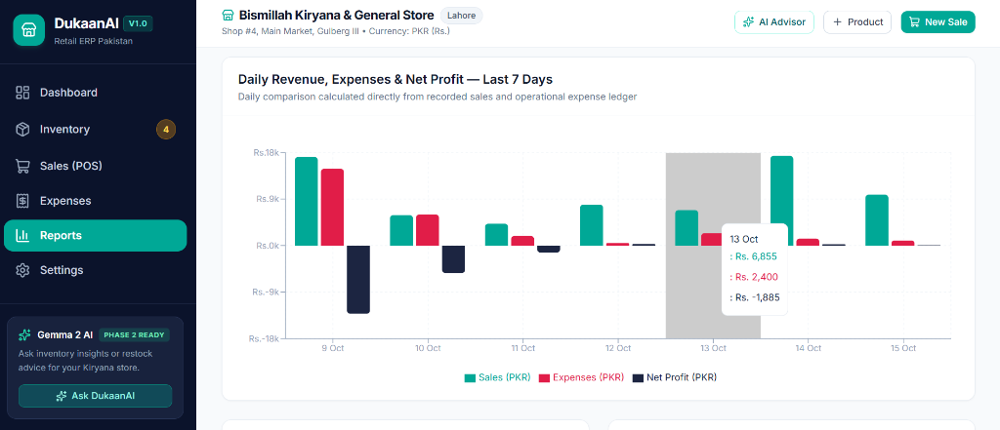
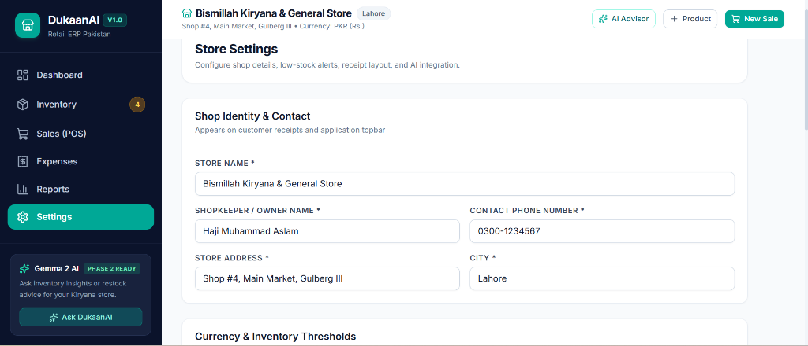

# DukaanAI (دکان اے آئی) — Phase 1 MVP

**AI-Assisted Inventory & Business Management System for Pakistani Retailers**

DukaanAI is a modern, production-quality retail ERP designed specifically for Kiryana stores, general stores, and small merchants across Pakistan. It combines point-of-sale (POS) checkout, atomic stock tracking, business expense logging, and P&L analytics formatted in Pakistani Rupees (PKR / Rs.).

Phase 1 establishes a rock-solid, fully typed full-stack foundation with an architectural service layer reserved for **Google's Gemma open-weight LLM** running locally via **Ollama** in Phase 2. Zero paid AI APIs are used.

---

## 🌟 Highlights & Features

- **Store Dashboard**: Live overview with today's gross sales, operating expenses, estimated net profit, total items in catalog, low-stock alerts, 7-day sales vs. expenses trend chart (Recharts Area), and recent counter transactions.
- **Inventory Management**: Real-time product tracking with instant search, category filters, stock level badges, purchase cost vs. selling price, profit margin % calculations, low-stock threshold alerts, quick stock adjustments (+/- units with audit reasons), and full CRUD.
- **Point of Sale (POS) & Checkout**: Fast counter checkout workflow with category pills, live stock validation (strictly prevents selling items beyond stock), quantity stepper, PKR discount calculator, payment method selector (Cash, JazzCash, EasyPaisa, Bank Transfer, Udhaar/Khata), customer details, and thermal receipt view with 1-click printing.
- **Expenses Ledger**: Record daily store operational expenditures (Shop Rent, LESCO/K-Electric Electricity Bills, Helper Wages, Chai/Refreshments, Goods Rickshaw Carriage, Packaging Bags), categorized with percentage distribution.
- **Financial Reports & P&L**: Filter by Today, Yesterday, Last 7 Days, Last 30 Days, or This Month. View Total Revenue, Wholesale Cost of Goods Sold (COGS), Gross Profit, Operating Expenses, Net Margin %, top 10 revenue-generating products, expense breakdowns, payment method splits, and instant CSV export (Sales, Expenses, Inventory).
- **Store Settings & Pakistani Retail Defaults**: Configured for PKR (`Rs.`), store name, shopkeeper name, address, customizable receipt footer ("JazakAllah Khair!"), and global low-stock threshold. Includes a 1-click **Reset Demo Data** button for hackathon demonstrations.
- **Phase 2 Gemma / Ollama Ready**: Clean decoupled `AIService` interface (`GET /api/ai/status`, `POST /api/ai/query`) that automatically detects local Ollama servers running `gemma3:1b`, while providing deterministic retail heuristic guidance when offline.

---

## 📸 Application Screenshots & Visual Walkthrough

Explore **DukaanAI** running live with authentic Pakistani Kiryana retail data:

### 1. Store Executive Dashboard
| 📊 Today's Overview & Live KPIs | 📈 7-Day Revenue & Expense Trend (Recharts) |
|:---:|:---:|
| [](docs/screenshots/01_dashboard_overview.png) | [](docs/screenshots/02_dashboard_trend_chart.png) |
| **Figure 1.1: Live Store KPIs**<br>• Real-time tracking: Today's Sales (`Rs. 9,855`), Daily Expenses (`Rs. 950`), Net Profit (`Rs. 54`)<br>• 4 critical low-stock warnings across 25 active retail products<br>• Quick POS checkout and manual expense shortcuts | **Figure 1.2: Trend Analytics & Restock Watchlist**<br>• Interactive Recharts dual-area curve comparing sales against operational costs<br>• Quick-action restock table for items near or below safety thresholds (Lifebuoy, Rooh Afza, Lays) |

---

### 2. Inventory & Counter Point of Sale (POS)
| 📦 Catalog & Stock Management | 🛒 Fast Counter Checkout (POS) |
|:---:|:---:|
| [](docs/screenshots/03_inventory_management.png) | [](docs/screenshots/04_point_of_sale_pos.png) |
| **Figure 2.1: Inventory Management**<br>• Instant multi-field search (title, barcode, SKU, category)<br>• Category pills filter + single-click Low Stock toggle<br>• Profit margin % calculation per SKU and full CRUD | **Figure 2.2: Point of Sale (POS) Register**<br>• Product cards grid with live unit stocks and instant add-to-cart<br>• Quantity steppers, discount calculator, and customer info<br>• Payment methods: Cash (`Naqd`), JazzCash, EasyPaisa, and Udhaar |

---

### 3. Business Expenses & Operational Ledger
| 💸 Operating Expenses Ledger & Heads Breakdown |
|:---:|
| [](docs/screenshots/05_business_expenses.png) |
| **Figure 3.1: Expense Tracking & Category Progress Breakdown**<br>• Itemized records for Shop Rent (`Rs. 35,000`), LESCO commercial electricity bills (`Rs. 14,850`), helper wages (`Rs. 6,000`), and carriage<br>• Category spending percentage bars with instant CSV export |

---

### 4. Financial Reports & Store Settings
| 📑 Profit & Loss (P&L) Executive Summary | 📊 Multi-Bar Daily P&L Chart |
|:---:|:---:|
| [](docs/screenshots/06_reports_pnl_summary.png) | [](docs/screenshots/07_reports_daily_chart.png) |
| **Figure 4.1: Financial P&L Statement**<br>• Total Revenue (`Rs. 69,200`), Wholesale COGS (`Rs. 62,434`), Net Profit Margin<br>• Single-click CSV data export for Sales, Expenses, and Inventory Valuation | **Figure 4.2: Daily Financial Breakdown Chart**<br>• Interactive Recharts bar visualization showing daily revenue, cost, and net profit<br>• Detailed hover tooltips showing line-by-line metrics per calendar date |

| ⚙️ Store Configuration & Local AI Status |
|:---:|
| [](docs/screenshots/08_store_settings.png) |
| **Figure 4.3: Shop Profile & Settings**<br>• Custom store identity (*Bismillah Kiryana Store*, Haji Muhammad Aslam, Lahore)<br>• Locked Pakistani Rupee (`Rs.`) standard and global safety thresholds<br>• Local Gemma 3 AI connectivity status and 1-click Demo Data Reset |

---

## 🛠️ Technology Stack

| Layer | Technology |
|---|---|
| **Frontend** | React 19, TypeScript, Vite 8, Tailwind CSS, Recharts, Lucide Icons |
| **Backend** | Python 3.11+, FastAPI, Uvicorn |
| **Database** | SQLite with SQLAlchemy 2.0 ORM |
| **Validation** | Pydantic v2 schemas |
| **Currency** | Pakistani Rupee (PKR / `Rs.`), `en-PK` international formatting |
| **AI Integration** | Phase 2 Gemma 3 (1B) open-weight model via local Ollama (zero paid APIs) |

---

## 📁 Repository Structure

```
DukaanAI/
├── backend/
│   ├── app/
│   │   ├── __init__.py
│   │   ├── config.py             # App settings & Ollama configurations
│   │   ├── database.py           # SQLAlchemy SQLite engine & session
│   │   ├── main.py               # FastAPI application with CORS & lifespan
│   │   ├── models/               # SQLAlchemy DB entities
│   │   │   ├── product.py        # Product catalog & stock
│   │   │   ├── sale.py           # Sale & SaleItem line items
│   │   │   ├── expense.py        # Business expense records
│   │   │   └── settings.py       # Store settings & receipt footer
│   │   ├── schemas/              # Pydantic v2 validation models
│   │   │   ├── product.py
│   │   │   ├── sale.py
│   │   │   ├── expense.py
│   │   │   ├── dashboard.py
│   │   │   ├── reports.py
│   │   │   ├── settings.py
│   │   │   └── ai.py
│   │   ├── services/             # Business logic layer
│   │   │   ├── product_service.py
│   │   │   ├── sale_service.py   # Atomic checkout & stock validation
│   │   │   ├── expense_service.py
│   │   │   ├── report_service.py # P&L calculations & CSV generators
│   │   │   ├── settings_service.py
│   │   │   └── ai_service.py     # Gemma / Ollama integration interface
│   │   └── seed.py               # 25 authentic Pakistani FMCG seed items & history
│   ├── tests/
│   │   └── test_api.py           # Pytest API suite
│   ├── verify_backend.py         # End-to-end backend verification script
│   ├── requirements.txt
│   └── .env.example
├── frontend/
│   ├── public/
│   ├── src/
│   │   ├── components/
│   │   │   ├── ai/AIAssistantModal.tsx
│   │   │   ├── expenses/ExpenseModal.tsx
│   │   │   ├── inventory/ProductModal.tsx
│   │   │   ├── inventory/StockAdjustModal.tsx
│   │   │   ├── layout/AppLayout.tsx, Sidebar.tsx, Topbar.tsx
│   │   │   ├── sales/ReceiptModal.tsx
│   │   │   └── ui/Button.tsx, Card.tsx, Input.tsx, Badge.tsx, Modal.tsx, StatCard.tsx, ConfirmDialog.tsx
│   │   ├── pages/
│   │   │   ├── DashboardPage.tsx
│   │   │   ├── InventoryPage.tsx
│   │   │   ├── SalesPage.tsx
│   │   │   ├── ExpensesPage.tsx
│   │   │   ├── ReportsPage.tsx
│   │   │   └── SettingsPage.tsx
│   │   ├── services/api.ts, types.ts
│   │   ├── utils/formatters.ts
│   │   ├── App.tsx
│   │   ├── main.tsx
│   │   └── index.css
│   ├── package.json
│   ├── vite.config.ts
│   ├── tailwind.config.js
│   └── tsconfig.json
├── README.md
└── .gitignore
```

---

## 🇵🇰 Seed Data Included (25 Pakistani Retail FMCG Items)

The database automatically seeds with realistic Kiryana goods and wholesale prices in PKR:
- **Groceries & Staples**: Dalda Cooking Oil (1L Pouch), Mezan Canola Oil (5L Tin), Guard Super Basmati Rice (1kg), Chakki Whole Wheat Atta (10kg), Daal Chana Special (1kg), Kolson Macaroni.
- **Spices & Masalas**: Shan Bombay Biryani Masala, Shan Korma Masala, National Red Chilli Powder (200g), National Chilli Garlic Sauce (500g).
- **Beverages & Tea**: Tapal Danedar Tea (450g), Vital Green Tea (30 bags), Rooh Afza Sharbat (800ml).
- **Dairy & Breakfast**: Olper's Full Cream Milk (1L), Tarang Tea Whitener (1L), Mitchell's Fruit Jam, Fauji Corn Flakes.
- **Snacks & Confectionery**: LU Prince Chocolate Biscuits, EBM Sooper Biscuits, Lays Masala Chips.
- **Personal Care**: Lifebuoy Total 10 Soap, Dettol Antiseptic Liquid (100ml).
- **Household & Cleaning**: Surf Excel (500g), Bonus Tristar Washing Powder (1kg), Rose Petal Maxob Kitchen Towels.
- **Historical Sales**: 27 sample counter sales over the past 7 days across Cash, JazzCash, EasyPaisa, and Udhaar.
- **Operating Expenses**: Shop Rent (Rs. 35,000), LESCO Commercial Bill (Rs. 14,850), Helper Wage (Rs. 6,000), Akbari Mandi Rickshaw Carriage (Rs. 1,850), Daily Staff Chai (Rs. 480).

---

## 🚀 Windows 11 Step-by-Step Setup & Launch Instructions

### Prerequisites
1. **Python 3.11+** installed (check with `python --version`). Ensure "Add Python to PATH" was checked during installation.
2. **Node.js 18+ and npm** installed (check with `node --version` and `npm --version`).

---

### Step 1: Clone or Navigate to the Workspace
Open Windows Terminal or PowerShell and navigate to the project directory:
```powershell
cd c:\Users\PMLS\.gemini\antigravity\scratch\DukaanAI
```

---

### Step 2: Start the FastAPI Backend

1. Navigate to the `backend` directory:
   ```powershell
   cd backend
   ```

2. (Optional but recommended) Create and activate a Python virtual environment:
   ```powershell
   python -m venv venv
   .\venv\Scripts\Activate.ps1
   ```

3. Install required Python packages:
   ```powershell
   pip install -r requirements.txt
   ```

4. Launch the FastAPI server with live reloading:
   ```powershell
   python -m uvicorn app.main:app --host 127.0.0.1 --port 8000 --reload
   ```

5. The backend will automatically:
   - Create the SQLite database (`dukaan.db`).
   - Seed all 25 Pakistani retail products, sales history, operating expenses, and store settings.
   - Serve interactive API docs at: [http://127.0.0.1:8000/docs](http://127.0.0.1:8000/docs).

---

### Step 3: Start the React + Vite Frontend

1. Open a **second** Windows PowerShell terminal window and navigate to the frontend directory:
   ```powershell
   cd c:\Users\PMLS\.gemini\antigravity\scratch\DukaanAI\frontend
   ```

2. Install npm dependencies (if not already installed):
   ```powershell
   npm install
   ```

3. Start the Vite development server:
   ```powershell
   npm run dev
   ```

4. Open your browser and navigate to:
   **[http://localhost:5173](http://localhost:5173)**

The frontend will load with full Pakistani Kiryana demo data, interactive charts, and live POS checkout!

---

## 🧪 Automated Testing & Verification

Run the comprehensive backend verification script:
```powershell
cd backend
python verify_backend.py
```
Expected output:
```
[OK] Total Catalog Products: 25
[OK] Categories Found: 7
[OK] Low-Stock Alerts Count: 4
[OK] Total Inventory Valuation: Rs. 157,781.00
[OK] Store Name: Bismillah Kiryana & General Store
[OK] Currency: PKR (Rs.)
[OK] Sale Created: Invoice #DUK-...
[OK] Atomic Stock Deduction verified
[OK] Excessive Stock Sale Properly Prevented
[OK] Business Expense Logged
[OK] Financial Summary Generated for 'Last 7 Days'
[OK] Sales, Expenses, and Inventory CSV generator verified.
ALL 8 VERIFICATION CHECKS PASSED!
```

---

## 🤖 Phase 2 Roadmap: Gemma Local AI Integration

DukaanAI is pre-architected to integrate Google's **Gemma open-weight model** via local **Ollama** in Phase 2:
1. **Download Ollama for Windows**: From [ollama.com](https://ollama.com).
2. **Pull Gemma**: Run `ollama run gemma2:2b` in your terminal.
3. **Seamless Handshake**: DukaanAI's `AIService` automatically detects the local Ollama instance on port 11434 and switches from heuristic guidance to local Gemma 2 reasoning.
4. **Privacy Guaranteed**: All retail and financial data remains 100% on the shopkeeper's Windows machine. No paid cloud tokens or subscriptions.
